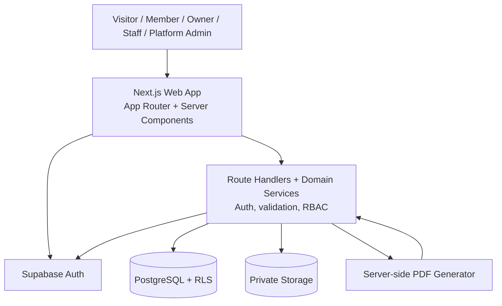
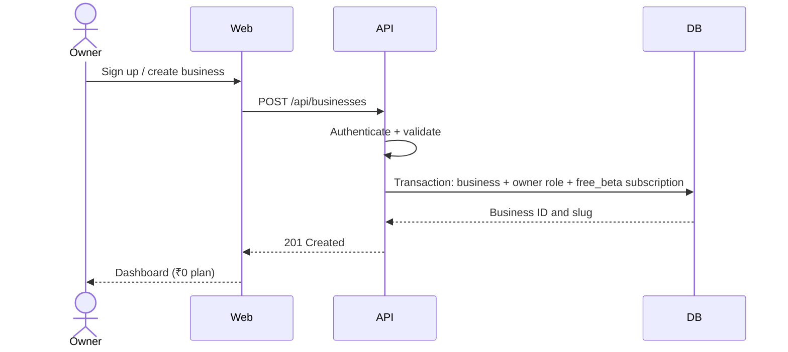
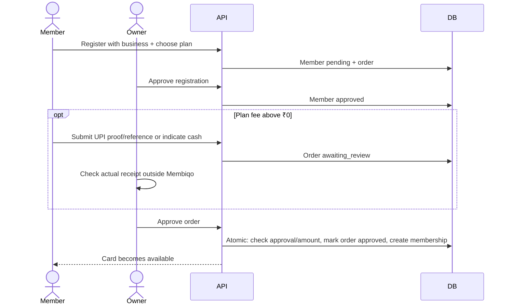
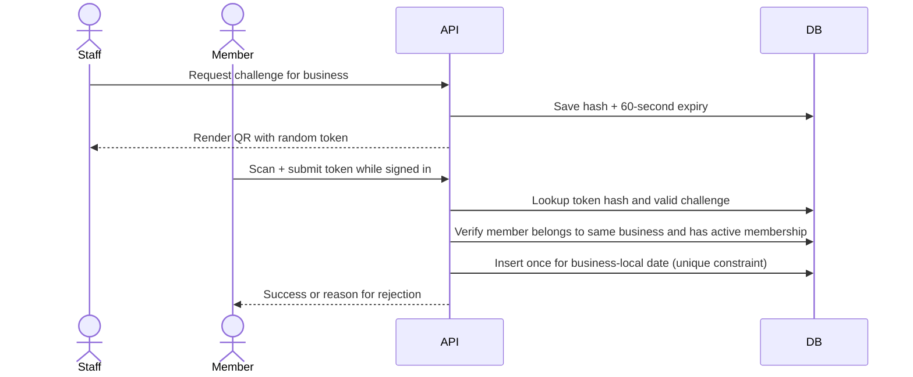

# Membiqo — Architecture (Exhibition MVP)

## 1. Architecture at a glance

**Approach:** One deployable Next.js web application, a managed Supabase backend, and strict business-level multi-tenancy. Avoid microservices for this phase.

- **Frontend:** Server-render business and member pages where suitable; client components for forms, QR camera, modal dialogs and live staff QR display.
- **Server API:** Route handlers authenticate user, parse/validate input, resolve business membership/permission, call transactional domain functions and return safe responses.
- **Database:** PostgreSQL constraints and RLS are the last line of tenant isolation, not just UI filtering.
- **Storage:** Private member pictures, business logos, payment evidence, and ephemeral/generated PDFs as needed.
- **QR:** Short-lived server-issued random challenge token; scanner sends token to server for verification.

## 2. Bounded modules

| Module | Responsibilities | Must not do |
|---|---|---|
| Identity | Auth, profile, session | Trust client-requested role |
| Business | Tenant onboarding, owners/staff, business settings, subscription | Query unscoped tenant data |
| Portal | Public business details and published plans | Leak private members |
| Members | Member registration, approval, manual owner entry | Auto-link accounts by phone |
| Plans & orders | Plan catalog, request, manual proof, approval | Treat screenshot as bank settlement |
| Memberships | Dates, activation, entitlement query | Persist stale active/expired flags |
| Attendance | Challenge issue/scan/unique check-in | Accept permanent QR or client time |
| Cards | PDF and opaque public verification token | Expose private PII in verification |
| Reports | Business-scoped aggregates | Count unverified orders as revenue |
| Platform admin | Tenant status, global metrics, audit | Expose privileged key to browser |

## 3. Trust boundaries and authorization

Every server write follows:

1. Retrieve signed-in identity from trusted server-side auth context; never from request body.
2. Validate request data with Zod, including UUIDs, slugs, prices, dates, and upload constraints.
3. Check tenant status and role: owner/staff permissions for management, member self-only for personal records.
4. Execute query with `business_id` scoped and RLS enforced; protect cross-tenant foreign keys in schema.
5. Write audit event for sensitive mutations. Return least-privilege response.

**Important:** A URL containing `businessId` does not prove access. An elevated service-role client bypasses RLS and must *never* be used in general request handlers without equivalent explicit server checks. Prefer user-scoped database clients for common actions. Use elevated credentials only in narrowly guarded internal functions/platform administration.

## 4. Multi-tenancy

- All business-owned entities include `business_id` and composite foreign keys preventing cross-tenant references.
- A `business_users` join supports an account owning/staffing multiple businesses.
- A `members` record represents a person's relationship with one business; the optional `user_id` links to a login, allowing the same login to be a member of multiple businesses.
- Public portal queries intentionally expose only approved business metadata and published plan data.
- Keep per-business timezone, category preset, and contact settings in `businesses`.

## 5. Key workflow diagrams

### Onboarding

### Membership activation

### QR attendance

## 6. Membership date/time model

Store `starts_at` and `ends_at` as UTC timestamps (`timestamptz`), with `ends_at` exclusive. Derive membership state via current server instant. For month/year durations, convert to the tenant's IANA timezone, add calendar units with end-of-month clamping, then convert back to UTC. Example: **2026-06-01 10:00 Asia/Kolkata + 1 calendar month → 2026-07-01 10:00 Asia/Kolkata**, exclusive. Add tests for leap days, Jan 31, and DST in non-Indian timezones.

Maintain a single `getMembershipState` domain function and an equivalent secure DB query/predicate. Do not use one-off date math in individual components.

## 7. Domain transactional invariants

- Creating a business must also create its owner role and zero-cost subscription in one transaction.
- Approving an order must atomically set order status and create **exactly one** membership; the schema prevents duplicate order activation.
- An active membership cannot overlap another active membership for the same member in MVP. Enforce through a transactional member lock plus membership overlap validation (and preferably PostgreSQL exclusion constraint as a further safeguard).
- QR check-in verifies challenge and membership in the same server transaction as attendance insert; use uniqueness to make retries harmless.
- Suspended tenants are denied new member registration, activation and check-in.

When a multi-step operation exceeds a simple RLS-constrained SQL query, implement a **narrow, audited PostgreSQL function** with carefully reviewed execution permissions and inputs, or a guarded server-side transaction mechanism. Never assume multiple independent REST writes are atomic.

## 8. Storage / privacy

- `business-logos`: may be public **only** after explicit business decision; otherwise signed asset URLs.
- `member-photos`: private. Authorized member and tenant staff may retrieve via server-issued short-lived URLs.
- `payment-proofs`: private and restricted to the submitting member and the owning business's staff. File extension alone is not sufficient validation.
- `cards`: ideally generated per authorized request from current data; avoid indefinitely public PDF URLs.
- `card_tokens`: opaque random tokens, token *hashes* persisted; the public verification endpoint reveals only validity and business name.

## 9. Availability and deployment

Deploy web to a supported Next.js host, managed database/auth/storage to Supabase, configure secret variables in server environment only, apply migrations with CI or migration tool, and test staging before exhibition. No cron, queue, gateway or paid third-party messaging is required for P0. In-app expiry labels are calculated on read. See `deployment.md`.

## 10. Extension path after exhibition

The modular monolith makes it possible to add optional capability modules (`batches`, `seats`, `bookings`) without changing core identity/tenant design. The platform-plan table allows introducing ₹99/month *later*, through an explicit opt-in upgrade flow and a real billing integration only when the business chooses one.
