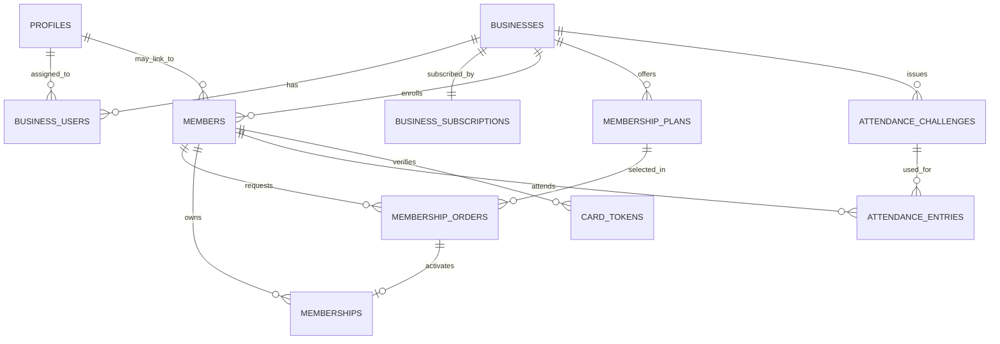

# Membiqo — Database & RLS Specification

**DB:** PostgreSQL (Supabase). IDs are UUIDs. Use migrations, not manually edited production tables. Every business-owned table carries `business_id`; `created_at` and `updated_at` are UTC `timestamptz` unless stated otherwise.

## 1. Data relationships



## 2. Table specification

| Table | Columns (essential) | Constraints / notes |
|---|---|---|
| `profiles` | `id uuid PK` → `auth.users.id`; `full_name text`; `phone text nullable` | One global login profile. No global client-editable role. |
| `businesses` | `id uuid PK`, `name text`, `slug text`, `kind text`, `timezone text`, `logo_path text?`, `contact_email text?`, `contact_phone text?`, `upi_qr_path text?`, `status text`, `created_by uuid` | Unique lowercase slug; allow only six configured kinds; active/suspended. |
| `business_users` | `id uuid PK`, `business_id uuid`, `user_id uuid`, `role text` | `role IN ('owner','staff')`; unique `(business_id,user_id)`; indexed. |
| `business_subscriptions` | `business_id uuid PK`, `plan_code text`, `monthly_price_paise int`, `currency text`, `status text`, `started_at timestamptz`, `ended_at timestamptz?` | Defaults: `free_beta`, `0`, `INR`, `active`. Nonnegative price. |
| `members` | `id uuid PK`, `business_id uuid`, `user_id uuid?`, `member_code text`, `full_name text`, `email text?`, `phone text?`, `photo_path text?`, `emergency_contact text?`, `registration_status text`, `created_at` | Unique `(business_id,member_code)`; unique `(business_id,user_id)` when `user_id` not null; status pending/approved/rejected. |
| `membership_plans` | `id uuid PK`, `business_id uuid`, `name text`, `description text?`, `duration_count int`, `duration_unit text`, `price_paise int`, `is_published bool`, `is_archived bool` | `duration_unit IN ('day','month','year')`; count > 0; price >= 0. |
| `membership_orders` | `id uuid PK`, `business_id uuid`, `member_id uuid`, `plan_id uuid`, `price_snapshot_paise int`, `payment_method text`, `payment_reference text?`, `payment_proof_path text?`, `status text`, `verified_by uuid?`, `verified_at timestamptz?` | Status: pending_payment / awaiting_review / approved / rejected / cancelled. Method: free / upi_manual / cash. Snapshot is immutable. |
| `memberships` | `id uuid PK`, `business_id uuid`, `member_id uuid`, `plan_id uuid`, `order_id uuid UNIQUE`, `starts_at timestamptz`, `ends_at timestamptz`, `cancelled_at timestamptz?` | `ends_at > starts_at`; active state derived. No mutable `status` column. |
| `attendance_challenges` | `id uuid PK`, `business_id uuid`, `token_hash text UNIQUE`, `expires_at timestamptz`, `created_by uuid`, `created_at` | Secure random token, hash in DB. QR token is not a permanent secret. |
| `attendance_entries` | `id uuid PK`, `business_id uuid`, `member_id uuid`, `challenge_id uuid`, `checked_in_at timestamptz`, `local_date date` | Unique `(business_id,member_id,local_date)` in v1. Only server computes `local_date`. |
| `card_tokens` | `id uuid PK`, `business_id uuid`, `member_id uuid`, `token_hash text UNIQUE`, `issued_at timestamptz`, `revoked_at timestamptz?` | Public verifier sees only limited fields; token lookup server-side. |
| `platform_admins` | `user_id uuid PK`, `created_at timestamptz` | Provision via privileged setup, never via sign-up form. |
| `audit_logs` | `id uuid PK`, `business_id uuid?`, `actor_user_id uuid?`, `action text`, `target_table text`, `target_id uuid?`, `safe_metadata jsonb`, `created_at` | Append-only, no tokens or raw sensitive fields. |

For every tenant-child relationship add **composite foreign keys** using `(id,business_id)` pairs and matching unique constraints on parent tables. For example, an order's `(member_id,business_id)` must refer to one member of the **same** business, and its `(plan_id,business_id)` to a plan of that business. Likewise memberships and attendance must not mix tenants.

## 3. Representative SQL skeleton

This is **illustrative, not a complete migration**. The agent must build and test ordered, idempotent migrations for every table.

```sql
create extension if not exists pgcrypto;

create table public.businesses (
  id uuid primary key default gen_random_uuid(),
  slug text not null unique check (slug ~ '^[a-z0-9]+(?:-[a-z0-9]+)*$'),
  name text not null,
  kind text not null check (kind in (
    'gym','yoga_studio','martial_arts','coaching_center','study_center','sports_academy'
  )),
  timezone text not null default 'Asia/Kolkata',
  status text not null default 'active' check (status in ('active','suspended')),
  created_by uuid not null references auth.users(id),
  created_at timestamptz not null default now(),
  updated_at timestamptz not null default now()
);

create table public.business_users (
  id uuid primary key default gen_random_uuid(),
  business_id uuid not null references public.businesses(id),
  user_id uuid not null references auth.users(id),
  role text not null check (role in ('owner','staff')),
  unique (business_id,user_id)
);

create table public.business_subscriptions (
  business_id uuid primary key references public.businesses(id),
  plan_code text not null default 'free_beta',
  monthly_price_paise integer not null default 0 check (monthly_price_paise >= 0),
  currency text not null default 'INR',
  status text not null default 'active' check (status in ('active','cancelled')),
  started_at timestamptz not null default now(),
  ended_at timestamptz
);

create index business_users_user_id_idx on public.business_users(user_id);
```

## 4. RLS strategy

RLS is enabled on *every* business-owned and sensitive table, including `business_subscriptions`, `card_tokens` and `audit_logs`. Default deny unless a policy explicitly permits access. Design **separate read and write policies**, as owners/staff and members may have different permissions. Public portal queries use a read-only narrow view or server endpoint—not a blanket anonymous select on business tables.

Example helper logic (implementation must review function ownership, grants, `search_path`, and avoiding RLS recursion):

```sql
-- Pseudocode shape. Implement security-definer ownership and grants safely.
create or replace function public.is_business_staff(target_business_id uuid)
returns boolean
language sql stable security definer
set search_path = ''
as $$
  select exists (
    select 1 from public.business_users bu
    join public.businesses b on b.id = bu.business_id
    where bu.business_id = target_business_id
      and bu.user_id = (select auth.uid())
      and bu.role in ('owner','staff')
      and b.status = 'active'
  );
$$;
```

Define policy intent:

- `profiles`: authenticated user selects/updates own safe fields only.
- `businesses`: a business owner/staff can read only assigned tenant; public limited profile through separate safe endpoint; mutation owner-only. Suspended tenant ordinary operations blocked.
- `business_users`: tenant owners can inspect and manage staff, but cannot casually grant platform admin rights; member cannot read.
- `members`: staff read tenant members; logged-in member reads their own tenant row. Registration created through validated server action; member cannot self-approve.
- `membership_plans`: public can see only published, non-archived plans via safe endpoint; staff can manage plans in their tenant.
- `membership_orders`: staff can review tenant orders; members read their own and submit proof only for own order. Approval is through server-controlled transaction.
- `memberships`: member reads only own; staff reads tenant; only guarded activation function inserts.
- `attendance_challenges`: no public raw hash access; staff creates via server path; member may redeem only using server path.
- `attendance_entries`: staff reads tenant; member reads their own; inserts only via guarded check-in operation.
- `business_subscriptions`: owner can view own subscription; only trusted server creates/modifies.
- `platform_admins`: no user-directed insert/update/delete; server checks against privileged table.
- `audit_logs`: restricted append and admin/owner-scoped safe reads where appropriate.

Do not expose `service_role` to the browser or rely on RLS policies alone for elevated operations.

## 5. Important indexes and integrity

- `businesses(slug)` unique; `business_users(user_id,business_id)`; `members(business_id,registration_status)`, `(business_id,member_code)` unique.
- `membership_plans(business_id,is_published)`.
- `membership_orders(business_id,status,created_at desc)`; `memberships(business_id,member_id,ends_at desc)`; `memberships(order_id)` unique.
- `attendance_challenges(token_hash)` unique; `attendance_entries(business_id,local_date)`; unique `(business_id,member_id,local_date)`.
- `card_tokens(token_hash)` unique; `audit_logs(business_id,created_at desc)`.
- Add DB constraint for no overlapping non-cancelled membership periods per member if feasible (GiST exclusion and `btree_gist`) **or** a thoroughly tested transactional lock and overlap check. This must remain safe with concurrent approvals.
- Foreign keys + RLS together protect against cross-business ID manipulation.

## 6. Example business subscription seed

```sql
-- Run inside guarded business-onboarding transaction with the new ID.
insert into public.business_subscriptions
  (business_id,plan_code,monthly_price_paise,currency,status)
values
  (:new_business_id,'free_beta',0,'INR','active');
```

## 7. Migration/seed checklist

1. Auth-linked profiles and base business tables.
2. Tenant-scoped members/plans/orders/memberships with composite FKs.
3. Attendance, cards, audits, indexes.
4. RLS policies and helpers, privileges and explicit revokes.
5. Seed **synthetic** gym and coaching/study-center data and safe test accounts using dev-only setup.
6. Run integration tests proving no tenant cross-access, forged `business_id`, duplicate check-in, double approval, or overlapping entitlements.
